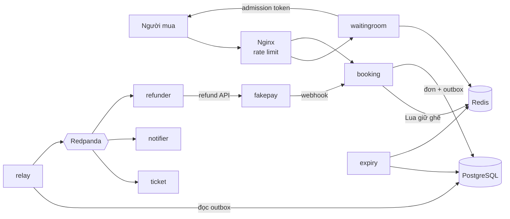

# TicketRush

Hệ thống bán vé sự kiện chịu tải cao, viết bằng Go.

Khi mở bán một concert, hàng chục nghìn người cùng bấm vào vài trăm ghế VIP trong vài giây. Hệ thống phải: không bao giờ bán một ghế cho hai người, giữ ghế có thời hạn trong lúc người mua thanh toán, xếp hàng người mua qua phòng chờ ảo, xử lý đúng webhook thanh toán bị trùng hoặc đến trễ, và vẫn đúng khi Redis, Kafka hay chính service chết giữa chừng.

Đặc tả đầy đủ: [SPEC.md](SPEC.md).

> **Trạng thái:** xong **M5 – phòng chờ ảo**. Hệ thống đã có:
> - giữ ghế bằng Redis (mặc định) hoặc PostgreSQL;
> - tạo, xem, huỷ đơn với Idempotency-Key;
> - expiry worker đưa đơn quá hạn sang `EXPIRED` và nhả ghế;
> - relay đẩy mọi sự kiện đơn hàng từ outbox lên Kafka;
> - thanh toán qua cổng giả lập fakepay (webhook trễ, trùng, gửi lại), đủ mọi nhánh của SPEC 9.3;
> - xuất vé có QR, hoàn tiền khi không giao được vé, thông báo qua log hoặc Telegram;
> - phòng chờ ảo: vào hàng, vị trí qua SSE, cấp admission token theo đúng thứ tự vào hàng; mỗi token tạo được một đơn;
> - frontend trong trình duyệt và nginx phía trước, có rate limit theo IP.
>
> Chưa có: metrics và tracing (M6), các kịch bản tải đầy đủ (M7), chaos (M8).

## Demo

Chạy cả hệ thống (mục [Chạy local](#chạy-local)) rồi mở http://localhost:8000. Đăng nhập bằng một user id bất kỳ, vào hàng chờ, chọn ghế khi đến lượt, thanh toán trên trang fakepay; trang đơn tự hiện mã QR khi vé được xuất. Mỗi tab là một người mua riêng.

`make e2e-browser` chạy đúng luồng đó cho hai người mua ở hai tab cùng lúc, bằng Chrome headless ([kết quả](docs/progress/m5.md#chạy-thử-đầu–cuối)).

## Kiến trúc



PostgreSQL là nguồn sự thật; Redis chỉ giữ trạng thái tạm và dựng lại được từ PostgreSQL. Chi tiết ở [SPEC.md mục 3](SPEC.md#3-kiến-trúc-tổng-thể).

## Kết quả đo

Đo bằng `make bench-hold BACKEND=<pg|redis>`:
- 3 lần mỗi backend, mỗi lần reset DB và seed lại;
- kịch bản mở bán 2.000 VU, mỗi vòng lặp là một người mua mới;
- sơ đồ ghế được hỏi lại bằng ETag;
- commit `3e31df4`, trên MacBook Apple M5 Pro 24 GiB.

**Số chính là latency phía server** (đo trong booking cho `POST /v1/orders`), trung vị [min–max]. Chi tiết ở [docs/results.md](docs/results.md#kịch-bản-etag-đo-lại-pg-và-redis).

| Backend | RPS giữ ghế đỉnh | 409 p50 | 409 p99 | 201 p50 | 201 p99 | Lỗi | Ghế bán trùng |
|---|---|---|---|---|---|---|---|
| pg | 2.048 [2.044–2.244] | 514 ms | 1.020 ms | 344 ms | 1.066 ms | 0% | 0 |
| redis | **4.038** [3.733–4.186] | **9,9 ms** | **208 ms** | **37 ms** | **238 ms** | 0% | 0 |

- p99 phía k6 (*k6 cùng máy, bị giới hạn CPU*): pg 1.019 ms, redis 347 ms.
- Với Redis và 20 kết nối, request thua dành 60% thời gian chờ pool PostgreSQL. Tăng lên 80 kết nối thì giảm còn 7%.
- Còn các lần khựng khoảng 200 ms ở cả Redis lẫn PostgreSQL chưa giải thích được; sẽ đo lại trên VPS ở M7.
- Vẫn chưa đạt mục tiêu ≥ 5.000 req/s và p99 < 200 ms.

[Điều tra M2](docs/results.md#điều-tra-m2): trước khi có ETag, k6 dùng khoảng 10/15 core để parse sơ đồ ghế 485 KB ở mỗi vòng lặp, làm p99 đo được lên khoảng 1 s. Kịch bản cũ được giữ trong `loadtest/hold_contention_full.js`.

Outbox relay (`make bench-relay`): xả 200.000 sự kiện lên Redpanda với trung vị **101.085 sự kiện/s** ([chi tiết](docs/results.md#outbox-relay)).

## Quyết định kỹ thuật

Danh sách đầy đủ ở [docs/adr/](docs/adr/README.md).

- [ADR-000](docs/adr/000-ban-goc-postgresql.md): làm bản gốc giữ ghế chỉ bằng PostgreSQL (`SELECT … FOR UPDATE`) trước khi dùng Redis.
- [ADR-001](docs/adr/001-giu-ghe-bang-redis-lua.md): giữ ghế bằng script Lua trong Redis; hash tag theo sự kiện; `HOLD_GRACE`.
- [ADR-002](docs/adr/002-transactional-outbox.md): transactional outbox + relay thay vì gửi Kafka trực tiếp; at-least-once; một relay để giữ thứ tự theo đơn.
- [ADR-003](docs/adr/003-saga-va-bu-tru-bang-hoan-tien.md): saga dạng choreography; mọi nhánh webhook quyết định trong một transaction; bù trừ bằng hoàn tiền; idempotency ở từng bước.
- [ADR-004](docs/adr/004-cach-chon-admit-batch.md): `ADMIT_BATCH = 200` tính từ throughput đo được của booking, giữ tải xấu nhất ở khoảng 27% năng lực đo được.
- [ADR-005](docs/adr/005-idempotency-key.md): Idempotency-Key: hash trên request đã chuẩn hoá. Khoá Redis cho request đang chạy trả `409 IDEMPOTENCY_KEY_IN_PROGRESS`; khi Redis không trả lời thì trả `503` (fail closed).
- [ADR-006](docs/adr/006-lua-chon-khi-spec-chua-ro-m1.md): các lựa chọn khi SPEC chưa nói rõ ở M1.

## API (booking, `:8080`)

| Method | Đường dẫn | Ghi chú |
|---|---|---|
| POST | `/v1/auth/dev-login` | `{"user_id": 123}` → JWT 24 h. Chỉ bật khi `APP_ENV=dev` |
| GET | `/v1/events/{id}` | Thông tin sự kiện, các khu và giá |
| GET | `/v1/events/{id}/seats` | 5.000 ghế kèm trạng thái và `version`; cache 500 ms, gzip; `ETag` + `If-None-Match` → `304` |
| POST | `/v1/orders` | Cần `Authorization`, `Idempotency-Key` (UUID) và `X-Admission-Token` từ phòng chờ (khi `REQUIRE_ADMISSION=true`, mặc định). 201 tạo mới, 200 gửi lại, 403 `ADMISSION_REQUIRED` / `ADMISSION_ALREADY_USED`, 409 `IDEMPOTENCY_KEY_IN_PROGRESS` khi request cùng key đang chạy. Có `payment_url` khi đơn `HELD` |
| GET | `/v1/orders/{id}` | Chỉ chủ đơn xem được; kèm danh sách vé khi đã `TICKETED` |
| POST | `/v1/orders/{id}/cancel` | Chỉ khi `HELD`; huỷ lại đơn đã huỷ vẫn trả 200 |
| GET | `/v1/orders/{id}/tickets` | Vé đã xuất, kèm QR dạng PNG base64 |
| POST | `/v1/webhooks/fakepay` | Không cần token; `X-Signature` = hex HMAC-SHA256 của raw body. Sai chữ ký trả 401, đã ghi nhận trả 200 (kể cả webhook trùng) |
| GET | `/healthz`, `/readyz` | readyz kiểm tra PostgreSQL và Redis |
| GET | `/`, `/app.js`, `/style.css` | Frontend |

Phòng chờ (`:8081`, qua nginx cùng origin với booking):

| Method | Đường dẫn | Ghi chú |
|---|---|---|
| POST | `/v1/queue/{id}/join` | Cần `Authorization`. `{"queue_id", "position"}`; gọi lại trả đúng `queue_id` cũ, `position` 0 nghĩa là đã được cho vào |
| GET | `/v1/queue/{id}/stream?queue_id=…` | Server-Sent Events: `position` mỗi 2 giây, rồi `admitted` kèm `admission_token`; `expired` nếu không còn trong hàng |

Lỗi luôn có dạng `{"error": {"code", "message", "details"}}`. Bảng mã lỗi ở [internal/httpx/errors.go](internal/httpx/errors.go).

## Chạy local

### Yêu cầu

- Go 1.27+
- Docker (trên macOS dùng OrbStack), Docker Compose v2
- `openssl`, `make`
- `sqlc` 1.31+, `goose` 3.x, `k6` (cài bằng `brew install sqlc goose k6`)

### Khởi động

```sh
make up            # postgres, redis, redpanda, redpanda console; chờ đến khi healthy
make migrate       # tạo schema
make seed          # sự kiện mẫu 5.000 ghế (sau make db-reset thì có id 1)
make run-booking   # lần đầu tự tạo .env từ .env.example với secret ngẫu nhiên
make run-relay     # terminal khác: outbox → Kafka (tạo topic orders.v1, tickets.v1 nếu thiếu)
make run-expiry    # terminal khác: đơn HELD quá hạn → EXPIRED, nhả ghế
make run-fakepay   # terminal khác: cổng thanh toán giả lập trên :8090
make run-ticket    # terminal khác: order.paid → sinh QR, đơn → TICKETED
make run-refunder  # terminal khác: order.refund_requested → fakepay hoàn tiền
make run-notifier  # terminal khác: log (hoặc Telegram) khi xuất vé, hoàn tiền
make run-waitingroom  # terminal khác: phòng chờ trên :8081
```

Sau đó mở http://localhost:8000 (nginx, chạy trong `make up`). Nếu `.env` được tạo từ mẫu trước M5 thì có dòng `REQUIRE_ADMISSION=false`: xoá dòng đó để booking đòi admission token.

Xem sự kiện trên Kafka: mở Redpanda Console tại http://localhost:8088, hoặc chạy `docker compose -f deploy/compose.yaml exec redpanda rpk topic consume orders.v1`.

Thử một lượt mua bằng curl, qua nginx:

```sh
TOKEN=$(curl -s -X POST localhost:8000/v1/auth/dev-login -d '{"user_id":123}' | jq -r .access_token)
QID=$(curl -s -X POST localhost:8000/v1/queue/1/join -H "Authorization: Bearer $TOKEN" | jq -r .queue_id)
curl -sN "localhost:8000/v1/queue/1/stream?queue_id=$QID"   # chờ sự kiện admitted, lấy admission_token
curl -s -X POST localhost:8000/v1/orders \
  -H "Authorization: Bearer $TOKEN" -H "Idempotency-Key: $(uuidgen)" -H "X-Admission-Token: <admission_token>" \
  -d '{"event_id":1,"seat_ids":["VIP-A-12","VIP-A-13"]}'
# Mở payment_url trong trình duyệt và bấm "Thanh toán thành công", rồi:
curl -s localhost:8000/v1/orders/<order_id>/tickets -H "Authorization: Bearer $TOKEN"
```

Các chế độ gây lỗi của fakepay (`FAKEPAY_DELAY_MS_*`, `FAKEPAY_DUPLICATE_RATE`, `FAKEPAY_LATE_RATE`, `FAKEPAY_5XX_RATE`) được liệt kê trong `.env.example`. Mặc định có 5% webhook đến trễ 11 phút; đặt `FAKEPAY_LATE_RATE=0` khi thử bằng tay.

`/readyz` trả `200` khi kết nối được PostgreSQL và Redis, `503` nếu không (body chỉ ghi `ok`/`fail` cho từng phụ thuộc, lý do lỗi nằm trong log). `/healthz` luôn trả `200` khi process còn sống.

| Dịch vụ | Địa chỉ |
|---|---|
| Frontend và API qua nginx | http://localhost:8000 |
| Booking API | http://localhost:8080 |
| Phòng chờ | http://localhost:8081 |
| Fakepay | http://localhost:8090 |
| PostgreSQL | `localhost:5432` (user/pass/db: `ticketrush`) |
| Redis | `localhost:6379` |
| Redpanda (Kafka API) | `localhost:19092` |
| Redpanda Console | http://localhost:8088 |

Dừng hạ tầng bằng `make down` (volume dữ liệu được giữ lại). Xem mọi target bằng `make help`.

### Cấu hình

Mọi cấu hình qua biến môi trường, liệt kê trong [.env.example](.env.example). Service kiểm tra cấu hình khi khởi động và thoát kèm danh sách **tất cả** biến thiếu/sai trong một lần. Bốn secret (`JWT_SECRET`, `ADMISSION_SECRET`, `WEBHOOK_SECRET`, `TICKET_SECRET`) bắt buộc, dài tối thiểu 32 ký tự và phải khác nhau. File `.env` không được commit.

### Kiểm thử và lint

```sh
make test              # unit test, bật race detector
make test-integration  # test tích hợp với PostgreSQL thật (testcontainers, cần Docker)
make lint              # gofmt, go vet, staticcheck, sqlc diff
```

Test tích hợp chạy trên PostgreSQL và Redis thật. Mỗi test có một database riêng, clone từ template đã migrate, và một Redis trống. Các test tranh chấp chạy cho **cả hai backend** giữ ghế:
- 1.000 goroutine cùng giữ `VIP-A-1` thì đúng 1 thành công;
- 200 goroutine giữ ngẫu nhiên 2 ghế trong 20 ghế thì không ghế nào thuộc hai đơn;
- 10 request song song cùng Idempotency-Key thì chỉ ra 1 đơn, và không request nào nhận `SEATS_UNAVAILABLE`;
- luồng HTTP đầu–cuối.

Ngoài ra có:
- test riêng cho từng script Lua;
- test expiry worker (4 worker chạy song song không xử lý một đơn hai lần);
- test relay trên Redpanda thật (đúng key và header, giữ thứ tự theo key, lỗi thì không mất dòng, 3 relay song song không gửi trùng);
- test đầu–cuối trong `internal/e2e`: đơn giữ 2 giây chuyển `EXPIRED`, ghế trống, và `order.expired` xuất hiện trên Kafka.

CI (GitHub Actions, [.github/workflows/ci.yaml](.github/workflows/ci.yaml)) có hai job:
- lint + unit test: gofmt, `sqlc diff`, `go vet`, staticcheck, `go test -race`;
- test tích hợp.

### Test tải

```sh
make bench-hold BACKEND=redis   # đo chuẩn: 3 lần, tự reset DB + seed + chạy booking, in trung vị/min/max
make bench-hold BACKEND=pg      # bản gốc để so sánh
make bench-relay                # throughput outbox relay (200.000 dòng, 3 lần)

# Hoặc chạy một lần với booking đang chạy sẵn:
make db-reset seed && make run-booking   # terminal khác
make load-hold                           # BUYER_MODE=vu để thử chế độ mỗi VU một người mua
```

`make bench` và chaos (`make chaos-*`) có từ M7/M8; hiện các target này báo "chưa triển khai" và trả exit code 1.

## Tiến độ

| Milestone | Nội dung | Trạng thái |
|---|---|---|
| M0 | Khung dự án, hạ tầng local, healthz/readyz, CI | Xong |
| M1 | Bản gốc chỉ dùng PostgreSQL | Xong |
| M2 | Giữ ghế bằng Redis Lua | Xong |
| M3 | Expiry worker và outbox | Xong |
| M4 | Fakepay, webhook, saga | Xong |
| M5 | Phòng chờ ảo, frontend | Xong |
| M6 | Quan sát hệ thống | Chưa làm |
| M7 | Test tải, kiểm tra bất biến | Chưa làm |
| M8 | Chaos testing | Chưa làm |
| M9 | Kubernetes, CI hoàn chỉnh | Chưa làm |

## Hạn chế đã biết

- Mỗi kết nối SSE của phòng chờ hỏi Redis 2 giây một lần; chưa đo chi phí với hàng chục nghìn người chờ.
- Người được cho vào mà không mua làm phí một lượt cho tới khi token hết hạn (5 phút).
- API tạo đơn cần Redis cho khoá idempotency, kể cả khi `INVENTORY_BACKEND=pg`. Redis không trả lời thì trả `503` ([ADR-005](docs/adr/005-idempotency-key.md)).
- Chưa có reconcile (M8).
  - Redis trong compose không có volume, nên `make down` rồi `make up` là mất dữ liệu Redis. Ghế đang giữ, và cả ghế **đã bán**, sẽ hiện là trống dù PostgreSQL vẫn có đơn `HELD` hoặc vé.
  - Lớp chặn cuối chống bán trùng là `UNIQUE` của bảng `tickets` khi thanh toán. Khi lớp này chặn, tiền được hoàn với lý do `SEAT_CONFLICT`, nhưng người mua đã phải trả tiền trước. Sau khi mất Redis, chạy `make db-reset seed` để bắt đầu lại sạch; lệnh này giờ xoá cả Redis.
- Một record lỗi mãi chặn cả consumer instance. Ví dụ fakepay sập thì refunder thử lại mãi ở một refund: mọi partition của instance đó phải chờ, và rebalance bị chặn ([ADR-003](docs/adr/003-saga-va-bu-tru-bang-hoan-tien.md)).
- Tiền chỉ được đảm bảo hoàn cho các webhook booking đã ghi nhận. Nếu fakepay bỏ cuộc sau 8 lần gửi lại (khoảng 255 s) trong lúc booking hoặc DB còn hỏng, giao dịch đó mất; chưa có đối soát với cổng thanh toán.
- Chưa có metric `double_sell_prevented_total`, `inventory_confirm_failures_total` (M6); hiện chỉ có log.
- Chạy nhiều relay cùng lúc có thể làm đảo thứ tự sự kiện của cùng một đơn; nên chạy một relay ([ADR-002](docs/adr/002-transactional-outbox.md)).
- Worker (expiry, relay, ticket, refunder, notifier) chưa có endpoint health và metrics (M6, M9).
- fakepay giữ trạng thái trong bộ nhớ; khởi động lại thì mất các thanh toán đã đăng ký và các webhook đang chờ gửi. fakepay chỉ gửi webhook về `PUBLIC_BASE_URL`, và chỉ dùng cho dev, không mở ra Internet.
- Sự kiện và ghế được cache trong process suốt vòng đời của nó; seed lại với sơ đồ khác thì phải khởi động lại booking.
- Cổng lắng nghe cố định theo SPEC (booking `:8080`), chưa cấu hình qua biến môi trường.
